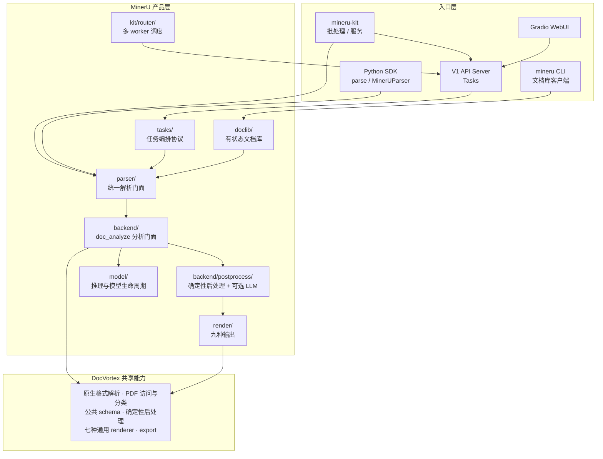
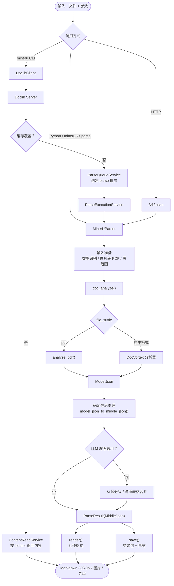
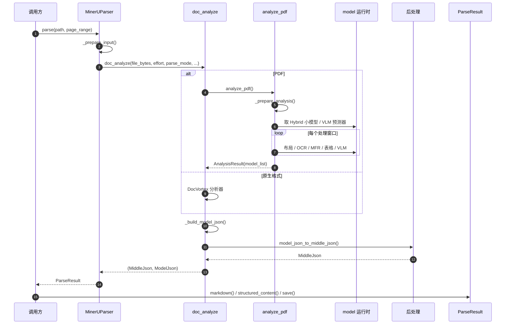
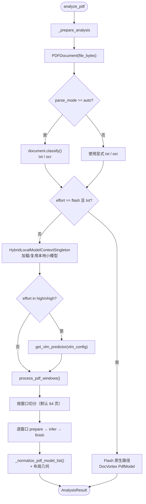
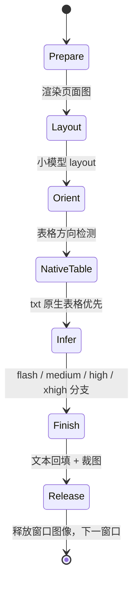
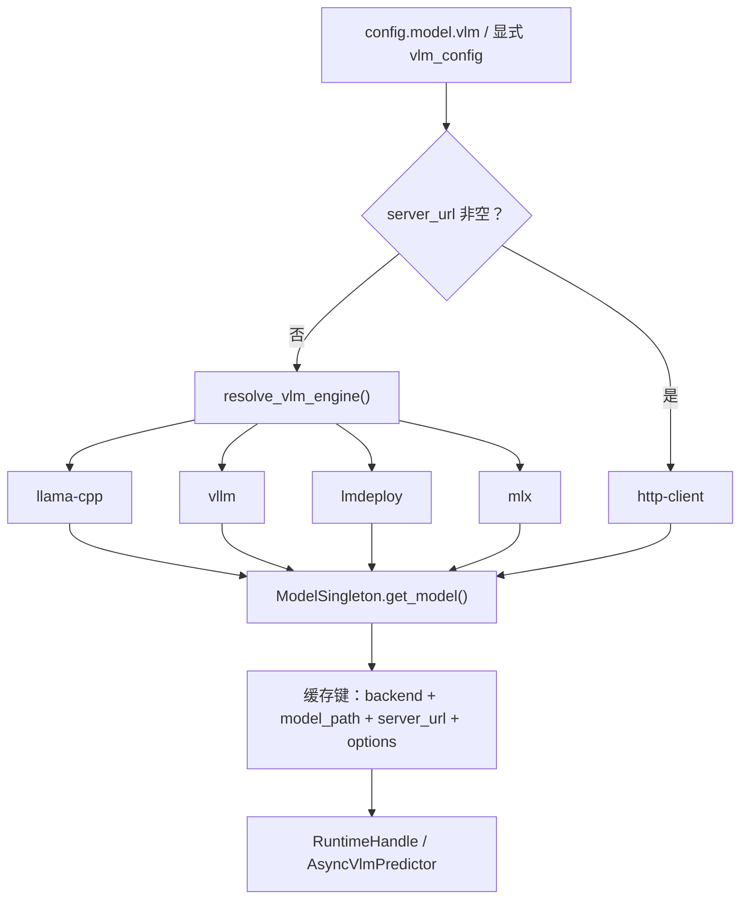
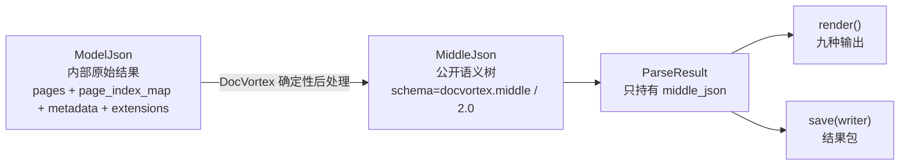
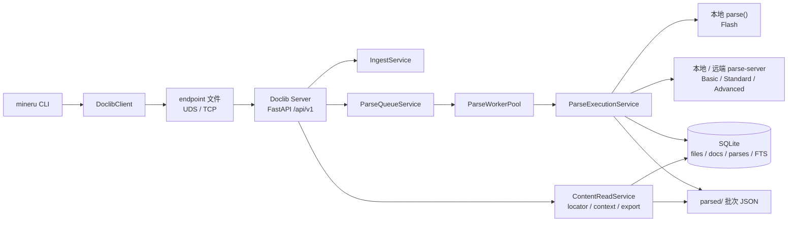
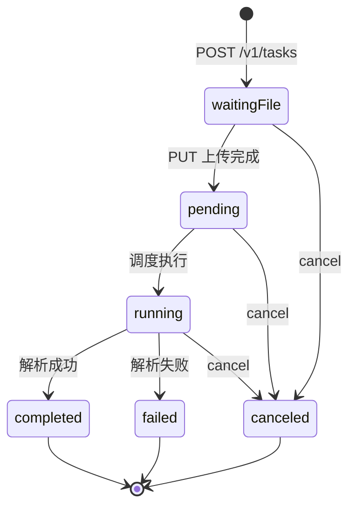

# MinerU 4.1 架构、解析流水线与源码导读

> 归档日期：2026-11-07
> 适用版本：MinerU **4.1.7**（Python `>=3.11,<3.15`）
> 核对基线：仓库 `master`（源码版本见 `mineru/version.py`）
> 定位：面向开发者与高级使用者的 step-by-step 技术文档。解释 MinerU 4.x 的分层、四档解析、PDF 流水线、模型运行时、结果协议、Doclib、HTTP 服务与扩展点，并给出源码调用链。
> 约定：本文所有结论以当前仓库源码与 `docs/next/` 内部设计文档为准；文件路径均相对仓库根目录。

---

## 0. 阅读路径

按角色选择入口：

| 目标 | 建议阅读顺序 |
| --- | --- |
| 只想把 MinerU 用起来 | [1. 技术概述](#1-技术概述) → [10. 使用手册](#10-使用手册) |
| 要理解一次解析内部发生了什么 | [2. 端到端流程](#2-端到端流程) → [3. 入口层](#3-入口层详解) → [4. 分析层](#4-分析层backend详解) |
| 要改代码 / 加功能 | [4. 分析层](#4-分析层backend详解) → [5. 模型运行时](#5-模型与运行时) → [11. 扩展开发](#11-扩展开发) |
| 要部署服务 / 集成 API | [7. Doclib](#7-有状态文档库doclib) → [8. HTTP 服务与 Router](#8-http-服务与-router) → [10. 使用手册](#10-使用手册) |

术语速查见 [附录 A](#附录-a术语表)；模块地图见 [附录 B](#附录-b模块地图)。

---

## 1. 技术概述

### 1.1 MinerU 是什么

MinerU 是一个**文档解析与结构化转换工具**：把 PDF、图片以及 Office、OpenDocument、EPUB、OFD、HTML/MHTML、CSV/TSV 等格式转换为统一的文档语义树（MiddleJson），再渲染为 Markdown、HTML、LaTeX、DOCX、EPUB、PDF、Structured Content、Content List V1/V2 九种输出。

MinerU 4.x 的产品形态不是一个单一脚本，而是一组协同能力：

| 形态 | 入口 | 特点 |
| --- | --- | --- |
| 无状态批处理 | `mineru-kit parse`、Python `parse()` | 直接解析文件，不使用数据库与缓存 |
| 本地文档库 | `mineru parse/read/search/scan/watch` | 有状态：入库、缓存、索引、断点续读 |
| HTTP 服务 | `mineru-kit api-server`（`/v1/tasks`） | 任务化、逐文件执行、结果下载 |
| 多 worker 调度 | `mineru-kit router` | 聚合多个解析服务，统一对外 |
| Web UI | `mineru-kit webui` | Gradio 界面，后端走 V1 API |
| 单文件同步包装 | `mineru-kit file-parse-server` | `/v1/file_parse` 同步等待附件 |

### 1.2 4.x 的核心设计取舍

理解 MinerU 4.x，抓住以下五条主线即可：

1. **能力归属分离（DocVortex × MinerU）**
   - `docvortex` 独立拥有：原生格式解析、PDF 基础访问与分类、公共文档 schema、确定性后处理、素材、七种通用渲染与导出。它不得反向依赖 MinerU。
   - MinerU 保留：OCR / VLM / Hybrid 推理、模型生命周期、可选 LLM 增强、tier 策略、CLI / API / Gradio / Doclib，以及 Content List V1/V2。
   - 依赖方向单向：MinerU → DocVortex 公开接口；MinerU 不导入 DocVortex 私有实现。
   - 依据：`CLAUDE.md`「DocVortex 与 MinerU 的文档架构」。

2. **确定性优先**
   - 模块边界显式导出 `__all__`；分派使用显式映射（如 `_OFFICE_MODEL_MAP`、`_TIER_TO_EFFORT`），避免运行时注册与动态发现。
   - `import` 不产生副作用；重依赖（torch、transformers 等）在函数体内惰性导入。
   - 这让静态分析、测试与 Agent 阅读都更可靠。

3. **隐私优先**
   - 没有显式远端配置（`server_url` / `--remote`），不会上传文档。
   - “存在 remote URL / API Key”不等于允许上传；必须由当前请求或 parsing-rule 显式允许。
   - 依据：`docs/next/invariants.md`、`docs/next/config.md`。

4. **档位化（tier）**
   - 对外四个产品档位：`flash` / `basic` / `standard` / `advanced`。
   - 对内四个分析强度：`flash` / `medium` / `high` / `xhigh`。
   - 档位决定是否使用小模型、是否使用 VLM、是否做两阶段抽取，而不是简单的“模型大小”。

5. **统计与生命周期显式化**
   - PDF 按“窗口”处理，单文档内存有上界；窗口准备/收尾持有本地模型锁，VLM 推理期间释放锁。
   - 资源所有权显式传递（`RuntimeOwner`、`runtime_document_scope`、`local_model_stage`），避免取消或异常时泄漏。
   - 依据：`mineru/backend/analysis/pdf/window.py`、`mineru/model/runtime/ownership.py`。

### 1.3 能力矩阵

**输入格式**（`mineru/filetypes.py`）：

| 类别 | 扩展名 | 解析路径 |
| --- | --- | --- |
| PDF | `pdf` | 四档：flash/basic/standard/advanced；支持页范围 |
| 图片 | `png jpg jpeg webp gif bmp tiff jp2` | 先转 PDF，再按四档解析；支持页范围 |
| Office | `doc docx ppt pptx xls xlsx rtf` | 原生 Flash（DocVortex） |
| OpenDocument | `odt ods odp` | 原生 Flash |
| E-book | `epub` | 原生 Flash |
| 版式文档 | `ofd` | 原生 Flash |
| 网页 | `html htm shtml mhtml mht` | 原生 Flash |
| 表格文本 | `csv tsv` | 原生 Flash |
| 纯文本 | `txt md rst tex adoc` 等 | 直接读取，不进入解析 |

**输出格式**（`mineru/render/`）：

| 格式 | 返回类型 | 归属 |
| --- | --- | --- |
| Markdown | `str` | DocVortex |
| HTML | `str` | DocVortex |
| LaTeX | `str` | DocVortex |
| DOCX | `bytes` | DocVortex |
| EPUB | `bytes` | DocVortex |
| PDF | `bytes` | DocVortex |
| Structured Content | `dict` | DocVortex |
| Content List V1 | `list[dict]` | MinerU |
| Content List V2 | `list[list[dict]]` | MinerU |

**四档语义**（`mineru/parser/tier.py` + `docs/next/tiers.md`）：

| tier | effort | PDF 执行方式 | 典型用途 |
| --- | --- | --- | --- |
| `flash` | `flash` | `txt`：DocVortex 原生 PDF 模型；`ocr`：布局小模型 + OCR | 预览、索引、低成本 |
| `basic` | `medium` | 小模型：layout + OCR + MFR（公式）+ 表格识别 | 本地基础质量 |
| `standard` | `high` | 小模型 + VLM 单步抽取（带布局块） | 默认高质量 |
| `advanced` | `xhigh` | 小模型 + VLM 两步抽取 + 图片分析 | 难文档、最高质量 |

### 1.4 分层架构



关键边界：

- **parser** 是本地/远程同步解析门面；**backend/analyze.py** 是“统一分析门面”；两者都不持有 Doclib 数据库。
- **doclib** 只通过 `parser.parse()` 或 `MinerUApiParser` 使用解析能力，不直接调用模型。
- **render** 不修改语义树，也不依赖已关闭的 PDF 对象。

### 1.5 关键概念

| 概念 | 含义 | 源码 |
| --- | --- | --- |
| tier | 产品档位 `flash/basic/standard/advanced` | `mineru/types.py` |
| effort | 分析强度 `flash/medium/high/xhigh` | `mineru/parser/tier.py` |
| small backend | 小模型执行后端 `onnx/torch` | `mineru/model/runtime/device.py` |
| VLM engine | `llama-cpp/vllm/lmdeploy/mlx` 或远程 HTTP | `mineru/model/vlm/selector.py` |
| ModelJson | 内部原始页面结果（含 page_index_map、扩展） | `mineru/types.py`（重导出 DocVortex） |
| MiddleJson | 带 schema 身份与元数据的有序页面语义树 | 同上 |
| ParseResult | SDK 结果对象，内部只持有 MiddleJson | `mineru/parser/base.py` |
| Doclib | 本地有状态文档库（入库、缓存、索引、读取） | `mineru/doclib/` |
| Task | HTTP 父任务 + 有序 files 清单 | `mineru/tasks/` |
| locator | `doc:{short_id}/tier:{tier}/page:{n}/block:{n}` | `mineru/doclib/locators.py` |

---

## 2. 端到端流程

### 2.1 全景流程图



### 2.2 三条主链路对比

| 维度 | 无状态解析 | Doclib 文档库 | Tasks HTTP |
| --- | --- | --- | --- |
| 入口 | `parse()` / `mineru-kit parse` | `mineru parse/read` | `POST /v1/tasks` |
| 是否有状态 | 否 | 是（SQLite + 文件缓存） | 任务状态在进程内 |
| 缓存 | 无 | 按 `sha256 + tier + 页范围` | 源文件 blob 复用 |
| 默认页范围 | 全部页 | `1-10`（`mino parse`） | 全部页 |
| 默认 tier | `standard` | 由服务能力决定（standard → basic） | standard → basic → flash → advanced |
| 结果 | `ParseResult` | 按 locator 读取 / 导出 | 每文件一个下载链接 |
| 适合 | 批处理、SDK 集成 | 本地知识库、Agent 阅读 | 服务化、多客户端 |

> 注意：三条链路共享同一个解析门面 `MinerUParser → doc_analyze()`，差异只在外围的状态与调度。

### 2.3 无状态解析时序



---

## 3. 入口层详解

### 3.1 CLI：两个入口

| 命令 | 定位 | 是否需要本地服务 | 核心源码 |
| --- | --- | --- | --- |
| `mineru` | 文档库客户端（parse/read/search/scan/watch/server/config…） | 需要 Doclib server | `mineru/cli/main.py` |
| `mineru-kit` | 无状态解析与服务工具（parse/webui/api-server/router/models/hardware…） | 不需要 | `mineru/kit/main.py` |

`mineru` 顶层命令显式注册，顺序由 `TOP_LEVEL_COMMAND_ORDER` 固定：

```python
# mineru/cli/main.py — 只注册命令，不在 import 时启动服务或加载模型
app.command("parse", help=t("Parse a document file."))(parse_cmd)
app.command("read", help=t("Read parsed document content by locator."))(read_cmd)
app.command("scan", help=t("Scan a file or directory into the document library."))(scan_cmd)
app.add_typer(watch.app, name="watch")
app.command("search", help=t("Search parsed document content."))(search_cmd)
app.command("find", help=t("Search filenames only (not document content)."))(find_cmd)
# … config / show / list / server / cleanup / forget / invalidate / telemetry / version
```

`mineru-kit` 使用**惰性命令解析**：根帮助只展示轻量描述，只有选中命令时才导入实现模块。这样 `--help` 不会触发模型或服务依赖：

```python
# mineru/kit/main.py
COMMANDS = {
    "parse": CommandSpec(".commands.parse", "parse_cmd", "Parse files or directories ..."),
    "webui": CommandSpec(".commands.webui", "webui_cmd", "Start the Gradio ..."),
    "api-server": CommandSpec(".commands.api_server", "api_server_cmd", "Start the self-hosted ..."),
    # ...
}

class OrderedRootGroup(TyperGroup):
    def resolve_command(self, ctx, args):
        name, command, remaining = super().resolve_command(ctx, args)
        spec = COMMANDS[name]
        module = import_module(spec.module, package=__package__)  # 只导入选中的命令
        ...
```

### 3.2 Python SDK 入口

`mineru/parser/__init__.py` 暴露两个便捷函数与两个解析器：

```python
def parse(
    path: str | Path,
    *,
    tier: Tier = "standard",              # flash / basic / standard / advanced
    ocr_mode: Literal["auto", "txt", "ocr"] = "auto",
    image_analysis: bool = True,
    page_range: str = "",                 # 仅 PDF；空字符串 = 全部页
    source_context: HtmlSourceContext | None = None,
    vlm_config: VlmConfig | None = None,
) -> ParseResult:
    configure_global_log_level()
    parser = MinerUParser(
        tier=tier,
        parse_mode=ocr_mode,
        image_analysis=image_analysis,
        vlm_config=vlm_config,
    )
    return parser.parse(path, page_range=page_range, source_context=source_context)
```

要点：

- `tier` 不接受 `None` / `auto`（这一点与 HTTP SDK 的 `null` 语义不同）。
- `vlm_config` 为 `None` 时使用全局配置；显式传入时完整覆盖，并在 `MinerUParser` 内 `model_copy(deep=True)`，避免调用方后续修改影响本次解析。
- `MinerUApiParser` 走 HTTP Tasks 协议，与 `MinerUParser` 共享 `ParseResult`。

### 3.3 输入准备：`MinerUParser._prepare_input`

这一步决定“文件被当成什么处理”。源码 `mineru/parser/mineru_parser.py`：

```python
def _prepare_input(self, path: Path, page_range: str = "", source_context=None) -> _PreparedInput:
    from .file_type import guess_suffix_by_path
    from .page_range import normalize_page_range_input

    # 1) 页范围先做语法归一（支持 1-5 / r1 / all 等）
    page_range = normalize_page_range_input(page_range)

    file_name = path.stem
    file_bytes = path.read_bytes()
    suffix = guess_suffix_by_path(path)
    source_suffix = suffix

    # 2) 图片统一转 PDF，后续走同一条 PDF 流水线
    if suffix in IMAGE_EXTENSIONS:
        from docvortex.document.pdf import PDFDocument
        file_bytes = PDFDocument.from_image(file_bytes).bytes
        suffix = "pdf"

    # 3) 类型校验；页范围只允许 PDF
    if suffix not in FILE_SUFFIXES:
        raise ValueError(f"Unsupported file type: {suffix or path.suffix or 'unknown'}")
    if source_suffix not in PAGE_RANGE_PARSE_EXTENSIONS and page_range.strip():
        raise InvalidRequestError(
            "page_range_invalid",
            f"Page range is only supported for PDF files; '{source_suffix}' uses full-document parsing.",
            "page_range",
        )

    # 4) HTML 需要来源上下文（用于解析相对资源）
    resolved_source_context = source_context
    if suffix == "html" and resolved_source_context is None:
        from docvortex.document.contracts import HtmlSourceContext
        resolved_path = path.resolve()
        resolved_source_context = HtmlSourceContext(
            source_uri=resolved_path.as_uri(),
            local_resource_root=resolved_path.parent,
        )

    # 5) 提取源文档属性（标题/作者等）；失败只告警，不阻断解析
    source_properties = (
        DocumentProperties()
        if source_suffix in IMAGE_EXTENSIONS
        else read_source_properties(file_bytes, cast(FileSuffix, suffix), resolved_source_context)
    )

    # 6) PDF 页范围重写 + 坏页记录
    file_bytes, retained_page_indices, broken_page_indices = self._maybe_adjust_pdf_bytes(
        file_bytes, suffix, page_range
    )
    return _PreparedInput(...)
```

#### 3.3.1 PDF 页范围重写

```python
def _maybe_adjust_pdf_bytes(self, file_bytes, suffix, page_range=""):
    if suffix != "pdf":
        return file_bytes, None, None

    from docvortex.document.pdf import PDFDocument
    from .page_range import parse_page_range

    with PDFDocument(file_bytes) as doc:
        page_count = doc.page_count
    page_indices = parse_page_range(page_range, page_count)

    # 整本请求不做重写，避免无意义的 IO 与对象重建
    if page_indices == list(range(page_count)):
        return file_bytes, None, None

    # 只保留请求页，并记录损坏页；重写后的 PDF 作为分析输入
    from docvortex.document.pdf.pdfium import safe_rewrite_pdf_bytes_with_pdfium_result
    rewrite_result = safe_rewrite_pdf_bytes_with_pdfium_result(file_bytes, page_indices=page_indices)
    if rewrite_result.used_original:
        return rewrite_result.pdf_bytes or file_bytes, None, rewrite_result.broken_page_indices
    return (
        rewrite_result.pdf_bytes or file_bytes,
        rewrite_result.retained_page_indices,
        rewrite_result.broken_page_indices,
    )
```

解析完成后，`_insert_broken_pages` 会把坏页补成空的 `PageInfo`，保证页号与源文档一致：

```python
pages_by_index = {page.page_idx: page for page in pages}
ordered_page_indices = sorted(set(pages_by_index) | set(broken_page_indices))
pages[:] = [pages_by_index.get(page_idx, PageInfo(page_idx=page_idx)) for page_idx in ordered_page_indices]
```

**页码约定**：内部 `page_idx` 从 0 开始；面向用户的页码从 1 开始；`page_range` 是字符串范围，`pages` 是页面数组，二者不能混用。

### 3.4 tier → effort → 运行时依赖

```python
# mineru/parser/tier.py
_EFFORT_BY_TIER: Final[dict[str, str]] = {
    "flash": "flash",      # 原生解析或 Flash OCR
    "basic": "medium",     # 小模型
    "standard": "high",    # 小模型 + VLM 单步
    "advanced": "xhigh",   # 小模型 + VLM 两步
}
```

依赖预检按“实际后端组合”判断，而不是按档位粗暴判断：

```python
def required_modules_for_tier(tier, *, vlm_config=None) -> list[str]:
    modules = ["onnxruntime"]
    if resolve_small_model_backend() == "torch":
        modules.extend(TORCH_REQUIRED_MODULES)
    settings = vlm_config if vlm_config is not None else get_config().model.vlm
    # 只有 standard 且没有远程地址时，才要求本地 VLM 引擎
    if tier == "standard" and not settings.server_url:
        modules.extend(VLM_REQUIRED_MODULES[resolve_vlm_engine(settings.engine)])
    return list(dict.fromkeys(modules))
```

`missing_modules_for_tier` 只把“模块本身缺失”记为缺依赖；依赖内部损坏的异常原样抛出，避免掩盖真实问题。

---

## 4. 分析层（backend）详解

### 4.1 统一门面 `doc_analyze()`

`mineru/backend/analyze.py` 是所有解析路径的汇合点。它做三件事：

1. 参数校验（effort、file_suffix、page_index_map）；
2. 按 `file_suffix` 路由到具体分析器；
3. 把分析结果包装为 `ModelJson`，再交给后处理生成 `MiddleJson`。

```python
def doc_analyze(
    file_bytes: bytes,
    effort: AnalyzeEffort = "high",
    parse_mode: ParseMode = "auto",
    image_analysis: bool = True,
    page_index_map: list[int] | None = None,
    file_suffix: FileSuffix = "pdf",
    source_context: HtmlSourceContext | None = None,
    vlm_config: VlmConfig | None = None,
    source_properties: DocumentProperties | None = None,
) -> tuple[MiddleJson, ModelJson]:
    configure_global_log_level()
    _validate_analyze(effort, file_suffix, page_index_map)   # 先校验，再加载重依赖

    if source_properties is None:
        source_properties = read_source_properties(file_bytes, file_suffix, source_context)

    if file_suffix == "pdf":
        from .analysis.pdf.pipeline import analyze_pdf
        result = analyze_pdf(file_bytes, effort=effort, parse_mode=parse_mode,
                             image_analysis=image_analysis, vlm_config=vlm_config)
    elif file_suffix in ("csv", "tsv"):
        from .analysis.csv import analyze_csv
        result = analyze_csv(file_bytes)
    elif file_suffix == "epub":
        from .analysis.epub import analyze_epub
        result = analyze_epub(file_bytes)
    elif file_suffix == "html":
        from .analysis.html import analyze_html
        result = analyze_html(file_bytes, source_context=source_context)
    elif file_suffix == "mhtml":
        from .analysis.mhtml import analyze_mhtml
        result = analyze_mhtml(file_bytes, source_context=source_context)
    elif file_suffix == "ofd":
        from .analysis.ofd import analyze_ofd
        result = analyze_ofd(file_bytes)
    else:
        from .analysis.office import analyze_office
        result = analyze_office(file_bytes, cast(OfficeSuffix, file_suffix))

    model_json = _build_model_json(result, file_suffix, page_index_map, source_properties)

    # 确定性后处理由 DocVortex 完成；MinerU 只在其后追加可选 LLM 增强
    from .postprocess.document import model_json_to_middle_json
    middle_json = model_json_to_middle_json(
        model_json, llm_aided_config=get_config().llm_aided
    )
    return middle_json, model_json
```

**异步入口** `aio_doc_analyze()` 只在“远程 HTTP VLM 或 vLLM”时走原生异步；其余路径回退到受控线程，避免把所有引擎都伪装成异步：

```python
native_async = False
if file_suffix == "pdf" and effort in {"high", "xhigh"}:
    from ..model.vlm.client import uses_native_async_vlm
    native_async = await run_sync(uses_native_async_vlm, vlm_config)

if not native_async:
    return await run_sync(doc_analyze, ...)
```

### 4.2 ModelJson 的构造

```python
def _build_model_json(result, file_suffix, page_index_map, source_properties) -> ModelJson:
    _log_infer_performance(file_suffix, len(result.model_list), result.elapsed)

    # 记录“实际执行”的产品档位与最终文字模式，而不是请求值
    extensions = build_metadata(effort=result.effort, parse_mode=result.parse_mode)

    # PDF 的布局几何只服务渲染；按页范围映射后写入扩展
    if file_suffix == "pdf" and result.layout_geometry is not None:
        from docvortex.document.pdf.layout import LAYOUT_EXTENSION, remap_layout_geometry
        extensions[LAYOUT_EXTENSION] = remap_layout_geometry(result.layout_geometry, page_index_map)

    return ModelJson(
        pages=result.model_list,
        page_index_map=page_index_map or [],
        metadata=DocumentMetadata(
            file_suffix=file_suffix,
            producer=Producer(name="mineru", version=mineru_version),
            document=source_properties.model_copy(deep=True),
        ),
        extensions=extensions,
    )
```

要点：

- `extensions["mineru"]` 只包含 `tier` 与 `parse_mode`，由 `MinerUMetadata` 以 `extra="forbid"` 严格校验；不记录 `effort`、`mineru_version` 等字段。
- 生产者版本位于 `metadata.producer.version`。
- `ModelJson` 只用于内部分析与后处理，**不进入公开结果包**。

### 4.3 原生格式分支

Office/ODF/EPUB/OFD/HTML/MHTML/CSV 全部由 DocVortex 的轻量分析器完成，MinerU 只负责路由与统一元数据：

```python
# mineru/backend/analysis/office.py
_OFFICE_MODEL_MAP = {
    "doc": DocModel, "docx": DocxModel, "ppt": PptModel, "pptx": PptxModel,
    "xls": XlsModel, "xlsx": XlsxModel, "rtf": RtfModel,
    "odt": OdtModel, "ods": OdsModel, "odp": OdpModel,
}

def analyze_office(file_bytes: bytes, file_suffix: OfficeSuffix) -> AnalysisResult:
    office_model = _OFFICE_MODEL_MAP[file_suffix]()       # 显式映射，无动态注册
    infer_started_at = time.perf_counter()
    model_list = office_model.predict(BytesIO(file_bytes))
    return AnalysisResult(
        model_list=model_list,
        effort="flash",       # 原生格式实际按 flash/txt 记录
        parse_mode="txt",
        elapsed=time.perf_counter() - infer_started_at,
    )
```

**重要语义**：非 PDF 原生格式不支持 `basic/standard/advanced`；即使调用方传了质量档位，实际记录仍是 `flash`。CLI 单文件会对显式质量档位报错，批量则把原生文件归一为 `flash`。

### 4.4 PDF 分析生命周期

`mineru/backend/analysis/pdf/pipeline.py` 是所有 PDF 档位共享的生命周期骨架：

```python
def analyze_pdf(file_bytes, effort="high", parse_mode="auto", image_analysis=True, vlm_config=None):
    with runtime_document_scope():                    # 文档级资源作用域
        state = _PDFAnalysis()
        try:
            with stage_timer("pdf.prepare"):
                _prepare_analysis(state, file_bytes, effort, parse_mode, vlm_config)
            infer_started_at = time.perf_counter()
            model_list = process_pdf_windows(
                file_bytes, state.document,
                effort=effort, parse_mode=state.parse_mode,
                image_analysis=image_analysis,
                flash_txt_mode=state.flash_txt_mode,
                hybrid_model=state.hybrid_model,
                vlm_predictor=state.predictor,
            )
            result = _build_pdf_analysis_result(state, model_list, effort, infer_started_at)
        finally:
            with stage_timer("pdf.cleanup"):
                _close_analysis(state)                 # 先关文档，再回收设备缓存
        return result
```

`_prepare_analysis` 的决策链：

```python
state.document = PDFDocument(file_bytes)

# auto 模式由 DocVortex 分类：有可用文本层走 txt，否则走 ocr
if parse_mode == "auto":
    parse_mode = state.document.classify()
if parse_mode not in ["txt", "ocr"]:
    raise ValueError(...)
state.parse_mode = cast(ResolvedParseMode, parse_mode)
state.flash_txt_mode = effort == "flash" and state.parse_mode == "txt"

# Flash + txt 完全不加载本地模型；其他情况必须加载 Hybrid 小模型
if not state.flash_txt_mode:
    from ....model.runtime.hybrid import HybridLocalModelContextSingleton
    state.hybrid_model = HybridLocalModelContextSingleton().get_model()
    acquire_document(state.hybrid_model.device)
    if effort in {"high", "xhigh"}:
        state.predictor, _backend = get_vlm_predictor(vlm_config)
```

生命周期图：



### 4.5 PDF 窗口编排

#### 4.5.1 为什么需要窗口

PDF 页数可能很大；如果一次性渲染全本，内存不可控。MinerU 用“处理窗口（processing window）”把页分组：

- 窗口大小由 `MINERU_PROCESSING_WINDOW_SIZE` 控制，默认 **64 页**；
- 每个窗口独立完成：渲染 → 布局 → 原生表格 → 推理 → 文本回填 → 裁图；
- 窗口之间共享同一个 `PDFDocument` 与模型实例，但页面图像与临时数组按窗口释放。

```python
def _configured_window_size(default: int = 64) -> int:
    import os
    raw_value = os.getenv("MINERU_PROCESSING_WINDOW_SIZE")
    if raw_value is None:
        return default
    try:
        return max(1, int(raw_value))
    except ValueError:
        logger.warning(...)
        return default
```

#### 4.5.2 窗口状态机



#### 4.5.3 窗口准备（`_prepare_pdf_window`）

```python
# 仍在本地模型锁内执行：渲染 + 布局 + 原生表格
images_list = load_images_from_pdf_bytes_range(
    pdf_bytes=file_bytes, document=document,
    start_page_id=window.start, end_page_id=window.end, image_type="pil_img",
)
np_images = [np.asarray(pil_image).copy() for pil_image in images_pil_list]

# 小模型布局：一次处理整个窗口
images_layout_res = local_model_context.layout_model.batch_predict(
    images_pil_list, batch_size=min(8, BATCH_RATIO * LAYOUT_BASE_BATCH_SIZE)
)

# 表格方向检测（flash/medium/high；xhigh 由 VLM 处理布局）
if effort in ["flash", "medium", "high"]:
    table_items = _collect_table_items(images_layout_res, np_images)
    if table_items:
        _apply_table_orientations(...)

# txt 且 medium/high：优先使用 PDF 原生表格（结构更准）
if parse_mode == "txt" and effort in {"medium", "high"}:
    native_table_summary = _apply_native_txt_table_priority(...)

# high 档把原生表格块从 VLM 输入中拆出，VLM 只处理其余布局
if parse_mode == "txt" and effort == "high":
    high_vlm_blocks, accepted_native_tables = _split_native_high_table_blocks(vl_style_layout_blocks)
```

#### 4.5.4 窗口推理（`_process_pdf_window`）

关键并发设计：**准备与收尾持有本地模型锁，VLM 推理期间释放锁**。

```python
with local_model_stage(hybrid_model.device):        # 取得本地模型执行锁
    state = _prepare_pdf_window(...)                # 渲染 + layout + 原生表格
try:
    result = state.vl_style_layout_blocks
    if effort in {"high", "xhigh"}:
        options = _inference_options(state, effort, parse_mode, image_analysis)
        if effort == "high":
            # Standard：VLM 直接基于外部布局块抽取
            result = vlm_predictor.batch_extract_with_layout(**options)
        else:
            # Advanced：VLM 两步抽取（先版面/内容，再细化）
            result = vlm_predictor.batch_two_step_extract(**options)

    result = _prepare_window_result(state, result, effort=effort, parse_mode=parse_mode)

    # high/xhigh + txt：表外行内公式切片交给 VLM 文本识别
    if state.inline_recognition is not None and state.inline_recognition.crops:
        with stage_timer("pdf.inline_vlm"):
            state.inline_outputs = vlm_predictor.batch_recognize_text(state.inline_recognition.images)

    with local_model_stage(hybrid_model.device):    # 收尾重新取得锁
        return _finish_pdf_window(state, result, effort=effort, parse_mode=parse_mode, hybrid_model=hybrid_model)
finally:
    state.close()                                   # 释放窗口图像与几何缓存
```

`_inference_options` 明确了两点：

```python
options = {
    "images": state.images_pil_list,
    # 图片分析只在 Advanced（xhigh）开启，Standard 不传该能力
    "image_analysis": image_analysis if effort == "xhigh" else False,
}
if effort == "high":
    options["blocks_list"] = state.high_vlm_blocks   # Standard 使用外部布局块
if parse_mode == "txt":
    options["not_extract_list"] = NOT_EXTRACT_TYPES  # 文本型块不需要 VLM 复述内容
```

#### 4.5.5 窗口收尾（`_finish_pdf_window`）

```python
# high/xhigh + txt：先把 VLM 行内公式识别结果落到 sidecar
inline_options = {}
if state.inline_recognition is not None:
    inline_options["recognized_inline_formulas"] = finish_inline_recognition(
        state.inline_recognition, state.inline_outputs, hybrid_model, np_images, page_offset=window.start
    )

if effort == "flash":
    # Flash OCR：OCR det/rec 填正文与表格
    window_model_list = _process_flash_ocr(...)
    for page_model_list in window_model_list:
        page_model_list[:] = optimize_hybrid_formula_number_blocks(page_model_list)
else:
    # medium/high/xhigh：OCR + 公式 + 表格 + 正文行级回填
    window_model_list = _process_text_and_formulas(..., **inline_options)

# 印章识别：medium/high 使用独立 OCR；xhigh 用 VLM 结果补图片容器
if effort in {"medium", "high"}:
    _apply_seal_ocr(local_model_context, window_model_list, np_images)
elif effort == "xhigh":
    _supplement_missing_image_block_containers(window_model_list, vl_style_layout_blocks)

# 最后统一裁剪视觉块图片（image/table/chart/equation）
with stage_timer("pdf.image_assets"):
    _attach_visual_block_images(window_model_list, images_list, page_start_index=window.start)
```

### 4.6 各阶段细节

#### 4.6.1 布局分析（Layout）

- 模型：PP-DocLayoutV2（Torch）或 ONNX 版本。
- 输入：整页 PIL 图像。
- 输出：每个块的 `label`、`bbox`、`score`，label 包括 `text`、`title`、`table`、`image`、`inline_formula`、`display_formula`、`page_number`、`header`、`footer` 等。
- 源码：`mineru/model/layout/pp_doclayoutv2.py`（Torch）、`pp_doclayout_v2_onnx.py`（ONNX）。

布局结果不会直接成为最终块，还要经过：

- 标题拆分（`_apply_layout_title_split`）；
- 表格方向检测（`_apply_table_orientations`）；
- 原生表格优先（`_apply_native_txt_table_priority`）；
- 视觉容器补齐（`_supplement_missing_image_block_containers`）。

#### 4.6.2 原生文本提取（PDF 文本层）

`txt` 模式优先使用 PDF 文本层，而不是 OCR。核心在 `mineru/backend/analysis/pdf/text/content.py`：

```python
# 页面字符数不超阈值时，才尝试原生文本
try:
    page_char_count = pdf_page.get_char_count()
except Exception:
    page_char_count = None

if not isinstance(page_char_count, int) or page_char_count <= MAX_NATIVE_TEXT_CHARS_PER_PAGE:
    evidence = prepare_text_evidence(
        pdf_page,
        geometry=page_text_geometry,
        vector_geometry=vector_geometry,
        excluded_script_regions=inline_math_regions,   # 行内公式区域不取文本
        table_regions=table_regions,                   # 表格区域不取文本
    )
    page_spans = _fill_native_pdf_text_spans(...)
```

设计要点：

- 公式区域与表格区域会从文本证据中排除，避免同一内容被“文本 + 公式/表格”重复消费。
- 字符数超限（扫描件或异常文本层）时退回 OCR。
- 支持快照缓存（`PageSnapshotCache`），把同一页的文本证据在布局与正文阶段复用，随后逐页释放。

#### 4.6.3 OCR（检测 + 识别）

由 parse_mode 与 effort 决定“只检测”还是“检测 + 识别”：

```python
def _build_ocr_det_type_and_mfr_enable(parse_mode, effort) -> tuple[set[str], bool]:
    if effort == "medium":
        # Basic：小模型公式识别开启；OCR 检测覆盖正文块
        return PIPELINE_DET_TYPE, True
    if parse_mode == "txt":
        # Standard/Advanced + 文本型 PDF：只补 OCR 检测，不跑 MFR
        return VLM_TXT_DET_TYPE, False
    # Standard/Advanced + OCR 型 PDF：VLM 识别正文，不跑 MFR
    return VLM_OCR_DET_TYPE, False
```

- `_ocr_det` 负责裁剪、批量检测、排序/合并检测框，并把公式区域遮罩掉；
- `_apply_ocr_rec_results` 负责批量识别；
- 识别结果以 sidecar 列表按页保存，最终由正文回填阶段消费。

#### 4.6.4 公式识别（MFR）

- 输入来自布局模型标注的 `inline_formula` / `display_formula` 框；
- Basic（medium）跑完整 MFR；Standard/Advanced 在文本模式下改由 VLM 识别表外行内公式切片，失败时局部回退 MFR；
- 行间公式结果按 bbox 精确回填到唯一的 `equation` 块：

```python
matched_blocks = equation_blocks_by_bbox.get(tuple(normalized_bbox), [])
if len(matched_blocks) != 1:
    raise ValueError("Hybrid medium display formula must match exactly one equation block ...")
matched_blocks[0]["content"] = formula.get("latex", "")
```

#### 4.6.5 表格识别

Basic（medium）的表格流程是“分类 → 无线模型批量 → 有线模型单表”：

```python
local_model_context.table_cls_model.batch_predict(table_tasks)       # 有线/无线分类
local_model_context.wireless_table_model.batch_predict(table_tasks)  # 无线表格批量
for table_task in table_tasks:
    if table_task["table_res"]["cls_label"] == WiredTable or (
        cls_label == WirelessTable and cls_score < 0.9
    ):
        wired_html = local_model_context.wired_table_model.predict(...)  # 有线表格逐表
        if wired_html is not None:
            table_task["table_res"]["html"] = wired_html
    html_code = _trim_medium_table_html(table_task["table_res"].get("html", ""))
    if html_code:
        table_task["table_block"]["content"] = html_code
```

补充规则：

- 原生表格优先：`txt` 且 medium/high 时，优先使用 PDF 原生表格结构；复杂表格回退模型；
- Flash OCR 表格：会先移除表内图片/公式/编号块，避免重复；
- 表格内容最终以 HTML 字符串写入 `table` 块。

#### 4.6.6 VLM 抽取（Standard / Advanced）

VLM 不是“重跑一遍 OCR”，而是作为版面与内容的高层理解器：

| 档位 | 方法 | 输入 | 说明 |
| --- | --- | --- | --- |
| standard (`high`) | `batch_extract_with_layout` | 页面图 + 外部布局块 | VLM 在给定布局上抽取内容 |
| advanced (`xhigh`) | `batch_two_step_extract` | 页面图 | 两阶段抽取，允许图片分析 |

文本模式（`txt`）下，表外行内公式切片还会调用 `batch_recognize_text`：

- 成功：直接回填文本或公式；
- 单片失败/空内容/定界符残缺：仅该切片回退 MFR，并记录告警；
- 取消、引擎死亡、程序契约错误：直接抛出，不降级。

#### 4.6.7 印章与视觉素材

- `_apply_seal_ocr`：medium/high 使用独立印章 OCR 模型；
- `_attach_visual_block_images`：按块 bbox 裁剪页面图，挂到 `image`/`table`/`chart`/`equation` 块；
- 图片以 base64 或素材引用形式进入 `MiddleJson`，渲染与导出时再物化。

### 4.7 档位行为差异矩阵

| 阶段 | flash + txt | flash + ocr | basic (medium) | standard (high) | advanced (xhigh) |
| --- | --- | --- | --- | --- | --- |
| PDF 文本层 | ✅ DocVortex 原生 | ❌ | ✅ | ✅ | ✅ |
| 小模型 layout | ❌ | ✅ | ✅ | ✅ | ✅ |
| OCR det | ❌ | ✅ | ✅ | ✅ | ✅ |
| OCR rec | ❌ | ✅ | ✅（ocr 模式） | VLM | VLM |
| MFR 公式 | ❌ | ❌ | ✅ | 局部回退 | 局部回退 |
| 表格模型 | ❌（原生） | ✅ | ✅ | ✅（原生优先） | ✅（原生优先） |
| VLM 抽取 | ❌ | ❌ | ❌ | ✅ 单步 | ✅ 两步 |
| 图片分析 | ❌ | ❌ | ❌ | ❌ | ✅ |
| 印章 OCR | ❌ | ❌ | ✅ | ✅ | ❌（VLM 补容器） |

### 4.8 后处理：ModelJson → MiddleJson

```python
# mineru/backend/postprocess/document.py
def model_json_to_middle_json(model_json: ModelJson, *, llm_aided_config: LLMAidedConfig) -> MiddleJson:
    # 1) DocVortex 的确定性后处理：合并、去重、层级、几何、sidecar 等
    middle_json = build_middle_json(model_json)

    # 2) 仅 PDF 执行 MinerU 的可选 LLM 增强（默认全关）
    if model_json.metadata.file_suffix == "pdf":
        apply_llm_aided_postprocess(middle_json, llm_aided_config)
    return middle_json
```

可选 LLM 能力（`llm_aided.features`）：

| 功能 | 作用 | 限制 |
| --- | --- | --- |
| `title_leveling` | 优化标题层级（2–6 级） | 只对整本 PDF 生效；抽页结果跳过 |
| `cross_page_table_cell_merge` | 跨页表格单元格合并 | 只消费确定性后处理已写入的 `continues_prev` |

两个功能共享一套 OpenAI-compatible 连接参数；任一启用时 `api_key`、`base_url`、`model` 必须非空。

---

## 5. 模型与运行时

### 5.1 模型资产仓库

`mineru/model/registry.py` 用显式 `ModelRepo` 描述四类资产：

| 仓库 | 用途 | 内容 |
| --- | --- | --- |
| `MinerU-4_models_torch` | Torch 小模型 | Layout / MFR / OCR / Table |
| `MinerU-4_models_onnx` | ONNX 小模型 | Layout / PP-OCRv6 / FormulaNet / SLANet / UNet |
| `MinerU2.5-Pro-2605-1.2B` | VLM 原始权重 | vLLM / LMDeploy / MLX |
| `MinerU2.5-Pro-2605-1.2B-GGUF` | VLM GGUF | llama.cpp 主模型 + mmproj |

下载来源支持 HuggingFace / ModelScope / 本地；`model.source=auto` 按可用性选择，并记录解析结果。目录完整性由 `.mineru_complete` 标记文件维护。

### 5.2 小模型后端选择

```python
# mineru/model/runtime/device.py
def resolve_small_model_backend(backend: str | None = None) -> Literal["onnx", "torch"]:
    selected = get_config().model.small_backend if backend is None else backend
    if selected in ("onnx", "torch"):
        return selected
    # auto：只有 Torch 依赖齐全且设备不是 CPU 时才用 Torch，否则 ONNX
    if all(module_available(name) for name in TORCH_REQUIRED_MODULES) and get_device().split(":")[0] != "cpu":
        return "torch"
    return "onnx"
```

设备选择顺序（`get_device`）：

1. 显式 `MINERU_DEVICE_MODE`；
2. CUDA；
3. MPS（Apple）；
4. NPU（torch_npu）；
5. XPU / GCU / MUSA / MLU / SDAA（按序探测）；
6. 回退 CPU。

### 5.3 VLM 引擎选择

```python
# mineru/model/vlm/selector.py
def resolve_vlm_engine(engine: str | None = None) -> VlmEngineName:
    selected = get_config().model.vlm.engine if engine is None else engine
    if selected in ("llama-cpp", "vllm", "lmdeploy", "mlx"):
        return selected
    if selected != "auto":
        raise ValueError(...)

    # 非 Linux/Windows 或 CPU：固定 llama.cpp
    if not (is_linux_environment() or is_windows_environment()):
        return "llama-cpp"
    if get_device().split(":", 1)[0] == "cpu":
        return "llama-cpp"
    # Linux GPU：优先 vLLM（如果已安装）
    if is_linux_environment() and module_available("vllm"):
        return "vllm"
    # 其余 GPU：LMDeploy（Intel XPU 除外）
    if get_device().split(":", 1)[0] != "xpu" and module_available("lmdeploy"):
        return "lmdeploy"
    return "llama-cpp"
```

**远程优先**：`model.vlm.server_url` 非空时，`get_vlm_predictor()` 直接构造 `http-client`，不再加载本地引擎：

```python
# mineru/model/vlm/client.py
if settings.server_url:
    predictor = ModelSingleton().get_model(
        backend="http-client",
        model_path=None,
        server_url=settings.server_url,
        model_name=settings.model or None,
        server_headers={"Authorization": f"Bearer {settings.api_key}"} if settings.api_key else {},
        http_timeout=settings.http_timeout,
        max_concurrency=settings.max_concurrency,
    )
    return predictor, "http-client"
```

### 5.4 ModelSingleton 与缓存键

VLM 客户端按 `(backend, model_path, server_url, options_fingerprint)` 缓存；同一进程内多次解析复用同一个运行时。初始化与关闭都通过屏障（`_initializing` / `_closing`）避免“关闭中的运行时被重新取用”。



### 5.5 资源所有权与并发

| 机制 | 作用 | 源码 |
| --- | --- | --- |
| `runtime_document_scope()` | 文档级资源作用域 | `mineru/model/runtime/ownership.py` |
| `acquire_document/release_document` | 每文档引用计数，最后一份释放时清缓存 | `mineru/model/runtime/execution.py` |
| `local_model_stage(device)` | 本地模型执行锁，避免多线程同时进入同一模型 | 同上 |
| `RuntimeOwner` | 记录运行时所有者，支持显式释放 | `mineru/model/runtime/ownership.py` |
| `trim_process_heap()` | 窗口结束/清理后归还堆内存 | `mineru/model/runtime/memory.py` |

并发原则：

- **单文档内存上界**：窗口串行处理；
- **不同文档可交错**：异步入口只在不同文档间交错推进；
- **VLM 等待期间不占本地模型锁**：让其他文档或窗口可以使用小模型。

---

## 6. 结果协议与渲染

### 6.1 三个对象的关系



| 对象 | 是否公开 | 内容 | 说明 |
| --- | --- | --- | --- |
| ModelJson | ❌ | raw pages、page_index_map、metadata、extensions | 只服务分析与后处理 |
| MiddleJson | ✅ | 有序 `PageInfo`（page_idx + blocks） | 带 schema 身份与版本 2.0 |
| ParseResult | ✅ | `middle_json` 一个字段 | 提供渲染、序列化、保存 |

### 6.2 MiddleJson 结构

- `schema = "docvortex.middle"`，`schema_version = "2.0"`；
- `metadata`：文件类型、生产者、源文档属性；
- `extensions["mineru"]`：实际执行的 `tier` 与 `parse_mode`；
- `pages`：`PageInfo[]`，每页 `page_idx` + `blocks`；
- `Block`：`text`、`title`、`table`、`image`、`equation`、`list`、`code`、`chart` 等；
- `InlineSpan`：文本、行内公式、代码、超链接等。

约束：

- 自然语言 `InlineSpan` 不携带字体或几何信息；
- 渲染与导出不得修改原语义树；
- 保存结果时先物化素材并校验，再写出，避免“看起来完整”的残缺结果包。

### 6.3 九种渲染格式

```python
# mineru/render/api.py（节选）
if output_format is RenderFormat.MARKDOWN:       return render_markdown(...)
if output_format is RenderFormat.HTML:           return render_html(...)
if output_format is RenderFormat.LATEX:          return render_latex(...)
if output_format is RenderFormat.DOCX:           return render_docx(...)
if output_format is RenderFormat.EPUB:           return render_epub(...)
if output_format is RenderFormat.PDF:            return render_pdf(...)
if output_format is RenderFormat.STRUCTURED_CONTENT: return render_structured_content(...)
if output_format is RenderFormat.CONTENT_LIST:   return render_content_list(...)
if output_format is RenderFormat.CONTENT_LIST_V2:return render_content_list_v2(...)
```

| 格式 | 选项类 | 返回 |
| --- | --- | --- |
| Markdown | `MarkdownRenderOptions` | `str` |
| HTML | `HtmlRenderOptions` | `str` |
| LaTeX | `LatexRenderOptions` | `str` |
| DOCX | `DocxRenderOptions` | `bytes` |
| EPUB | `EpubRenderOptions` | `bytes` |
| PDF | `PdfRenderOptions`（`PdfLayout.AUTO/ORIGINAL/REFLOW`） | `bytes` |
| Structured Content | `StructuredContentRenderOptions` | `dict` |
| Content List V1 | `ContentListRenderOptions` | `list[dict]` |
| Content List V2 | `ContentListV2RenderOptions` | `list[list[dict]]` |

### 6.4 结果包保存

```python
def save(self, writer: DataWriter) -> None:
    from docvortex.export import materialize_middle, validate_materialized_assets

    # 1) 在副本上物化素材，不修改原语义树
    middle_json, assets = materialize_middle(self.middle_json)
    validate_materialized_assets(middle_json, assets)

    exported = ParseResult(middle_json=middle_json)
    text_files = {
        "markdown.md": exported.markdown(),
        "middle_json.json": exported.to_json(),
        "structured_content.json": json.dumps(exported.structured_content(), ensure_ascii=False, indent=2),
    }

    # 2) 先完成全部序列化，再写文件；缺素材时在写出前失败
    for path, content in text_files.items():
        writer.write_string(path, content)
    for path, payload in sorted(assets.items()):
        writer.write(path, payload)
```

**结果包是唯一自包含的产物**；单独的 `middle_json.json` 不能替代带素材的包。Tasks 的多格式打包由 `mineru/parser/task_outputs.py` 单独实现（`default/docx/html/latex`），不要套用 `save()` 的布局。

---

## 7. 有状态文档库 Doclib

### 7.1 服务架构



### 7.2 启动与 endpoint 发现

`mineru/doclib/app.py` 的 `startup()` 顺序：

1. 创建数据目录与 SQLite，执行迁移，校验必需表；
2. 初始化 `FTSManager`、`ConfigService`、`TelemetryService`；
3. 构造 `IngestService`、`ParseQueueService`、`ParseExecutionService`、`ScanService`、`SearchService`、`CleanupService`；
4. 清理上次崩溃遗留的锁与运行态（`files.locked_at`、`parses.status=parsing` 等）；
5. 若 `parse_server.local.mode=managed`，启动托管 parse-server；
6. 启动后台任务：watch、scan、ingest、parse、device monitor、compaction、health check、telemetry flush。

传输发现：

- UDS 可用（Linux/macOS）默认启用 `doclib.sock`；
- Windows fallback 使用 TCP loopback，默认 `127.0.0.1:15980`；
- 实际地址写入 `~/.mineru/doclib.endpoint.json`，版本 3，包含 `pid`、`server_id`、`transports`；
- 客户端读取 endpoint 文件自动发现，显式 `base_url`/`socket_path` 时必须显式提供 token。

### 7.3 入库（IngestService）

- 以**路径**为实例、以**内容 sha256** 为文档身份；
- 多个路径可以指向同一内容；
- 文件状态：`active` / `deleted` / `unreachable`；
- 支持排除规则、watch 目录与解析规则。

### 7.4 排队与缓存（`request_parse`）

核心算法：按页去重，只解析缺失页。

```python
async def request_parse(self, path, *, tier=None, page_range=None, force=False, remote=False):
    page_range = normalize_page_range_input(page_range) or None

    # 1) 先刷新路径，确保 files.sha256 是当前内容
    refreshed = await self.ingest_svc.refresh_file(path, ensure_ingested=True, allow_images=True)
    ...
    sha256 = file_row["sha256"]

    # 2) 解析 tier（在缓存检查之前）
    if ext in TIERED_PARSE_EXTENSIONS:
        requested_tier = tier or parse_policy.resolve_default_tier(health=self.health, remote=remote)
    else:
        requested_tier = "flash"

    # 3) 默认页范围：已知页数取前 10 页，未知取第 1 页
    request_page_range = expand_page_range(
        page_range or parse_policy.default_parse_range(page_count), page_count or 1
    )
    needed = parse_page_range_set(request_page_range)

    # 4) 已完成且可读的批次覆盖的页，直接扣除
    if not force:
        done_batches = ...
        for batch in valid_done_batches:
            needed -= parse_page_range_set(batch["page_range"])
        if not needed:
            return _done_response(...)          # 纯缓存命中

    # 5) 正在排队/解析的批次覆盖的页，复用并把优先级提升到 1
    for batch in active_batches:
        if batch["id"] in reused_parse_ids and batch["priority"] < 1:
            await self.db.execute("UPDATE parses SET priority=1 ... WHERE id=?", ...)

    # 6) 仍缺的页创建新批次
    parse_id = await self.db.execute_insert(
        "INSERT INTO parses (sha256, tier, page_range, status, privacy, priority, ...) "
        "VALUES (?, ?, ?, ?, ?, 1, ...)",
        (sha256, requested_tier, uncovered_page_range, PARSE_STATUS_PENDING, privacy, now, now),
    )
    return ParseResponse(status=PARSE_STATUS_PENDING, wait_parse_ids=..., created_parse_ids=[parse_id], ...)
```

要点：

- **按页范围复用**：同一文档的不同页可以分批解析，最终按需合并；
- **force 只跳过 done 缓存**，不删除旧结果；
- **invalidate** 才会让未来解析和读取避免旧缓存，但不会自动触发新解析；
- 远端上传必须 `remote=True` 或规则显式允许。

### 7.5 执行（`process_doc`）

```python
async def process_doc(self, task: ParseRow) -> bool:
    # 抢占校验：状态必须仍是 parsing
    current = await self.db.fetchone("SELECT status FROM parses WHERE id=?", (task["id"],))
    if current is None or current["status"] != PARSE_STATUS_PARSING:
        return False

    file_row = await accessible_file_for_sha256(self.db, task["sha256"])
    ...
    if tier == "flash":
        result = await self._parse_via_local(file_row, tier, page_range)   # 直接本地 parse()
    else:
        result, via = await self._parse_via_api(file_row, tier, page_range, privacy)
        # API 目标：managed / self_hosted / remote；先探测健康与档位能力

    # 写批次 JSON；markdown 只为 FTS 生成，不持久化
    export_payload = result.to_dict(skip_defaults=True)
    write_parse_payload(json_path, export_payload)

    md_text = result.markdown(add_markers=False)
    await self._maybe_update_fts(sha256, tier, md_text, file_row)
    await self._maybe_update_docs_meta(sha256, tier)

    # 终态：done + 记录 via
    await self.db.execute(
        "UPDATE parses SET status=?, page_range=?, done_at=?, locked_at=NULL, via=?, updated_at=? WHERE id=?",
        (PARSE_STATUS_DONE, persisted_page_range, done_at_ms, via, done_at_ms, task["id"]),
    )
    return True
```

失败处理：任何异常都会写入 `failed`、记录 `error_code/error_msg`、释放锁；取消后迟到的结果不能改写终态。

### 7.6 读取与导出（ContentReadService）

`mineru read` 的行为：

- 接受 locator：`doc:{short_id}`、`/tier:{tier}`、`/page:{n}`、`/block:{n}`、`/char:{offset}`；
- 页码 1-based，字符偏移 0-based；
- `--context N`：页 locator 取上下 N 页，块 locator 取上下 N 块；
- `--limit`：输出字符预算，超出时返回续读游标；
- `--format image`：按页/块返回图片；
- 导出：`export_doc_content` 生成请求页范围的完整渲染内容。

**读取不会触发新的质量解析**；没有缓存时返回错误，而不是偷偷解析。

### 7.7 搜索与索引

- `fts_contents`：正文全文索引（按 tier 门槛更新）；
- `fts_filenames`：文件名索引；
- `mineru search` 只搜索已索引内容；`mineru find` 只搜索文件名；
- 低质量（如 flash）结果不足以回答时，应按默认质量重新解析或读取。

### 7.8 后台工作线程

| 循环 | 作用 | 默认间隔 |
| --- | --- | --- |
| `WatchLoop` | 监听目录事件，触发入库/扫描 | `scan_interval_sec=300` |
| `ScanWorkerPool` | 执行扫描任务 | 事件驱动 |
| `IngestWorkerPool` | 入库（哈希、元数据、索引） | 事件驱动 |
| `ParseWorkerPool` | 抢占并执行 parse 批次 | 事件驱动 |
| `DeviceMonitor` | 检测可插拔设备变化 | `5s` |
| `Compaction` | 合并同档位批次 JSON，减少碎片 | `3600s` |
| `ParseServerHealthCheck` | 探测本地/远端 parse-server 与档位 | `30s` |
| `TelemetryFlushLoop` | 遥测批量上报 | 内部默认 |

---

## 8. HTTP 服务与 Router

### 8.1 V1 Tasks 协议

资源模型：

| 资源 | 含义 |
| --- | --- |
| `file` | 源文件视图或解析产物 |
| `task` | 父解析任务，聚合逐文件状态与结果链接 |

端点：

| Method | Path | 用途 |
| --- | --- | --- |
| `POST` | `/v1/tasks` | JSON 清单创建任务，返回缺失文件上传链接 |
| `PUT` | 返回的上传链接 | 每个链接上传一个文件 |
| `GET` | `/v1/tasks/{task_id}` | 查询总状态与逐文件状态、结果链接 |
| `POST` | `/v1/tasks/{task_id}/cancel` | 取消未完成文件 |
| `GET` | `/v1/files/{file_id}` | 文件元信息 |
| `GET` | `/v1/files/{file_id}/content` | 下载结果 |
| `GET` | `/v1/health` | 健康检查 |
| `GET` | `/v1/models` | 模型列表 |
| `GET` | `/v1/tiers` | 档位能力 |
| `GET` | `/v1/usage` | 用量 |

状态机（逐文件）：



父任务状态：全部完成 = `completed`；部分成功 = `partial`；全部失败 = `failed`；出现取消 = `canceled`。**单个文件完成后即可下载它的结果，不要求父任务终结**。

### 8.2 API Server 结构

- 入口：`mineru-kit api-server` → `mineru/parser/api_server.py`；
- 源码文件较大（约 96 KB），包含：
  - `FileStore`：源文件 blob、结果文件、ID 预留、保留期；
  - `ExecutionStore`：执行、取消、结果租约；
  - 任务路由：`mineru/tasks/http.py`；
  - 执行协议：`mineru/tasks/service.py`、`execution.py`；
  - OpenAPI 请求 schema 与错误模型。
- `--tier` 控制服务开放的最高档位（包含较低档位）；`auto` 按硬件推荐；`create_app(tiers=...)` 保留精确集合。
- `--concurrency` 是解析任务并发；VLM 自身并发由 `model.vlm.max_concurrency` 控制。

### 8.3 Router

`mineru/kit/router/` 提供：

- worker 发现与健康检查；
- 认证；
- 调度（就绪文件分派给 worker）；
- 公共 ID 与下游 ID 映射；
- 源缓存与结果租约；
- 可选的独立 upstream 管理接口。

对外仍复用 Tasks 协议，客户端不需要知道 worker 数量与地址。

### 8.4 file-parse

`mineru-kit file-parse-server` 提供 `/v1/file_parse`：

- 单文件 multipart 上传，同步等待结果；
- 先持久化源文件和 `request_id`，再创建/上传/等待上游 Tasks；
- 取得上游 `task_id/file_id` 后先保存再查询；
- 等待超时返回 202，客户端断连不自动取消；
- 状态目录只恢复自身协议空间内的记录。

### 8.5 Gradio WebUI

`mineru-kit webui`：

- 未指定 `--api-url` 时托管本地 V1 API；
- 指定后使用该服务的能力发现（`/v1/tiers`）；
- 支持 PDF 预览、Office 预览、结果下载与格式转换；
- 清空、换文件、同会话重提、正常关闭会使旧任务失效并执行取消流程。

---

## 9. 配置系统

### 9.1 两阶段配置

| 阶段 | 来源 | 例子 |
| --- | --- | --- |
| 启动前 | `$MINERU_HOME/config.yaml` + 环境变量 + 默认值 | UDS/TCP、DB 路径、模型目录、日志、VLM 连接 |
| 运行时 | SQLite `config` 表、watch / rules 表 | `parse_server.local.mode`、远端 URL/Key |

`MINERU_HOME` 默认 `~/.mineru`；默认配置文件 `$MINERU_HOME/config.yaml`；`MINERU_CONFIG` 可显式指定配置文件路径。

### 9.2 优先级

1. 当前命令显式参数；
2. 当前进程环境变量；
3. 启动前文件配置或 SQLite 配置；
4. 内置默认值。

启动前配置与 SQLite 配置不定义同一个 key，避免隐式覆盖。

### 9.3 关键配置

| 分组 | 字段 | 默认值 | 说明 |
| --- | --- | --- | --- |
| model | `model.base_dir` | `~/.mineru/models` | 模型根目录 |
| model | `model.source` | `auto` | `auto/huggingface/modelscope/local` |
| model | `model.small_backend` | `auto` | `auto/onnx/torch` |
| model | `model.vlm.engine` | `auto` | `auto/llama-cpp/vllm/lmdeploy/mlx` |
| model | `model.vlm.server_url` | 空 | 非空即远程 VLM |
| model | `model.vlm.max_concurrency` | `100` | VLM 请求并发 |
| render | `render.latex_delimiters` | `$...$` / `$$...$$` | Markdown 公式定界符 |
| llm_aided | `features.title_leveling` | `false` | 标题分级 |
| llm_aided | `features.cross_page_table_cell_merge` | `false` | 跨页表格合并 |
| doclib | `doclib.parse_workers` | `2` | 解析 worker 数 |
| doclib | `doclib.ingest_workers` | `2` | 入库 worker 数 |
| doclib | `doclib.tcp.port` | `15980` | Windows TCP fallback |
| doclib | `doclib.managed_parse_server.port` | `16580` | 托管 parse-server 端口 |

环境变量按字段路径覆盖，例如：

```bash
MINERU_MODEL_VLM_SERVER_URL=http://127.0.0.1:30000/v1
MINERU_MODEL_VLM_API_KEY=...
MINERU_LOG_LEVEL=debug
MINERU_PROCESSING_WINDOW_SIZE=32
MINERU_DEVICE_MODE=cuda:0
```

### 9.4 运行时 KV

| key | 默认值 | 说明 |
| --- | --- | --- |
| `parse_server.local.mode` | `disabled` | `disabled/managed/self_hosted` |
| `parse_server.local.managed_tier` | `standard` | 托管服务能力上限 |
| `parse_server.local.self_hosted_url` | 无 | 自托管服务地址 |
| `parse_server.remote.url` | `https://mineru.net/api` | 远端解析地址 |
| `parse_server.remote.api_key` | 无 | 远端 Key |

修改方式：

```bash
mineru config set parse_server.local.mode managed
mineru config set parse_server.local.managed_tier basic
mineru config set parse_server.remote.api_key sk-...
```

---

## 10. 使用手册

### 10.1 安装

```bash
# 基础安装：ONNX + llama.cpp，可在 CPU 上运行
pip install -U "mineru>=4.0,<5"

# 需要 Torch 小模型（GPU/MPS）
pip install -U "mineru[torch]>=4.0,<5"

# 需要 vLLM / LMDeploy / MLX 的高吞吐部署
pip install -U "mineru[full]>=4.0,<5"
```

Python 版本 `>=3.11,<3.15`。安装后：

```bash
mineru --version
mineru-kit --help
```

### 10.2 常用 CLI

**无状态转换**（默认全部页）：

```bash
# 单文件 → Markdown
mineru-kit parse report.pdf -o report.md

# 指定档位与页范围
mineru-kit parse report.pdf -o report.md --tier standard --pages 1-10

# 批量目录 → 输出目录
mineru-kit parse ./papers -o ./out --format markdown

# 输出 Middle JSON
mineru-kit parse report.pdf -o out.json --format middle_json

# 打包 zip（含图片）
mineru-kit parse report.pdf -o out.zip --format zip
```

**文档库阅读**（默认前 10 页，按 locator 续读）：

```bash
mineru parse report.pdf                 # 输出 Markdown 到 stdout
mineru parse report.pdf --json          # 结构化状态 + 内容 + 续读信息
mineru parse report.pdf --pages all     # 整本
mineru parse report.pdf --tier basic
mineru read "doc:ab12cd3/tier:standard/page:11"
mineru read "doc:ab12cd3/tier:standard/page:4/block:7" --context 2
```

**发现与索引**：

```bash
mineru scan ~/Documents/project
mineru watch add ~/Documents
mineru search "revenue recognition"
mineru find "annual report" --ext pdf
```

**缓存控制**：

```bash
mineru parse report.pdf --force        # 本次跳过 done 缓存
mineru invalidate report.pdf --tier standard
mineru forget report.pdf               # 从库中移除记录，不删源文件
```

### 10.3 Python SDK

```python
from mineru.parser import MinerUParser, parse
from mineru.parser.writer import FileBasedDataWriter
from mineru.render import render, RenderFormat

# 1) 便捷函数
result = parse("report.pdf", tier="standard", page_range="1-5")

# 2) 结果对象
print(result.pages[0].page_idx)
md = result.markdown()
structured = result.structured_content()

# 3) 渲染其他格式
html = render(result.middle_json, RenderFormat.HTML)
docx_bytes = render(result.middle_json, RenderFormat.DOCX)

# 4) 保存结果包（Markdown + Middle JSON + Structured Content + 图片）
result.save(FileBasedDataWriter("output"))

# 5) 显式本地 VLM 配置（覆盖全局）
from mineru.config import VlmConfig
local = parse("report.pdf", tier="standard", vlm_config=VlmConfig())
```

### 10.4 服务部署

```bash
# 自托管解析 API（默认 127.0.0.1:8000）
mineru-kit api-server --host 127.0.0.1 --port 8000 --tier standard

# 预加载模型（减少首个请求延迟）
mineru-kit api-server --preload-models

# 多 worker Router
mineru-kit router

# 单文件同步包装
mineru-kit file-parse-server

# Web UI
mineru-kit webui
```

Doclib 的本地解析能力：

```bash
# 方式一：由 Doclib 托管 parse-server
mineru config set parse_server.local.mode managed
mineru config set parse_server.local.managed_tier standard

# 方式二：自托管
mineru-kit api-server --port 8000
mineru config set parse_server.local.mode self_hosted
mineru config set parse_server.local.self_hosted_url http://127.0.0.1:8000

# 方式三：远端（必须显式 --remote 才会上传）
mineru config set parse_server.remote.api_key sk-...
mineru parse report.pdf --remote
```

### 10.5 硬件与模型管理

```bash
mineru-kit hardware info          # 只读诊断
mineru-kit hardware detect        # 推荐档位
mineru-kit models list
mineru-kit models download --tier standard
mineru-kit models verify
```

---

## 11. 扩展开发

### 11.1 新增输入格式

MinerU 的格式边界由 `mineru/filetypes.py` 与 DocVortex 共同定义。新增格式通常分两种情况：

1. **DocVortex 已支持**：只需在 `filetypes.py` 的扩展名集合与 `FILE_TYPE_BY_EXTENSION` 中登记，并在 `doc_analyze()` 增加路由分支。
2. **DocVortex 未支持**：需要先在 DocVortex 增加分析器与 `FILE_SUFFIXES`，再回到 MinerU 登记；不要在 MinerU 中复制第二份原生解析实现。

检查清单：

- [ ] 扩展名加入正确的集合（`PARSEABLE_EXTENSIONS` / `INGESTIBLE_EXTENSIONS` / `DISCOVERABLE_EXTENSIONS`）；
- [ ] 是否需要页范围（目前只有 PDF 支持）；
- [ ] 是否只能走 flash（原生格式）；
- [ ] MIME 映射（API 上传/下载）；
- [ ] `doc_analyze()` 路由；
- [ ] Doclib 入库与扫描规则；
- [ ] 测试：单文件、批量、Doclib、API。

### 11.2 新增渲染格式

1. 在 `mineru/render/contracts.py` 的 `RenderFormat` 增加枚举值与选项类；
2. 在 `mineru/render/__init__.py` 导出；
3. 在 `mineru/render/api.py` 增加分支与返回类型 overload；
4. 如果属于“通用格式”，实现应放在 DocVortex；MinerU 只保留 Content List 这类产品专属格式；
5. 增加渲染测试（结构、图片、公式定界符、空块）。

### 11.3 新增 VLM 引擎

需要同时改动：

| 位置 | 改动 |
| --- | --- |
| `model/vlm/selector.py` | `VlmEngineName` / `_ENGINE_BACKENDS` / `VLM_REQUIRED_MODULES` / 自动选择逻辑 |
| `model/vlm/runtime.py` | `_create_model` 增加构造分支与关闭逻辑 |
| `model/registry.py` | 若权重格式不同，增加 `ModelRepo` |
| `parser/tier.py` | 依赖预检自动生效（按 `resolve_vlm_engine`） |
| `pyproject.toml` | 可选依赖 extra |
| 测试 | 构造、释放、异步、远程回退 |

原则：显式选择不要求下载端安装引擎；自动选择只探测已安装模块。

### 11.4 新增小模型

1. 在 `model/registry.py` 增加 `ModelPath`；
2. 在 `model/runtime/hybrid.py` 增加初始化函数与 `HybridLocalModelContext` 的懒加载属性；
3. 在 PDF 阶段接入调用与结果回填；
4. 分别验证 ONNX 与 Torch 两条路径（如果都支持）；
5. 更新模型下载、校验与 CI。

### 11.5 新增 Doclib API

1. 在 `mineru/doclib/types.py` 定义请求/响应模型；
2. 在 `mineru/doclib/services/` 实现服务方法；
3. 在 `mineru/doclib/server.py` 用 `@route(...)` 注册；
4. 在 `mineru/doclib/client.py` 增加同名客户端方法（`@route` 装饰器保持路径一致）；
5. 增加 SDK 文档与契约测试。

### 11.6 新增 LLM 后处理功能

1. `config.py` 的 `LLMAidedFeaturesConfig` 增加开关；
2. `backend/postprocess/llm_aided.py` 实现请求与结果校验；
3. 保证默认关闭、失败可回退、不修改原语义树；
4. 增加启用条件校验（连接参数非空）；
5. 测试：关闭、启用成功、启用失败、抽页/整本边界。

### 11.7 工程约束

来自 `CLAUDE.md`：

- 子模块之间使用相对导入；
- 模块 `__init__.py` 显式导出 `__all__`；
- 公开函数完整类型注解；
- import 不产生副作用，重依赖惰性加载；
- 格式化 ruff，行宽 128；
- lint：`C/E/F/W/ANN`，忽略 `C901/ANN204/ANN401`；
- 测试标记：`torch`、`accelerator`、`e2e`、`smoke`、`slow`、`remote`、`full_stack`、`isolated_home`、`lifecycle`。

---

## 12. 常见误区与排障

### 12.1 常见误区

| 误区 | 事实 |
| --- | --- |
| “tier 就是模型大小” | tier 是产品档位，决定是否用 VLM、是否两阶段、是否做图片分析 |
| “flash 一定比 basic 差” | 原生格式（Office/EPUB/OFD/HTML/CSV）只有 flash，质量由格式解析决定 |
| “auto 模式总是 OCR” | `auto` 由 DocVortex 分类：有文本层走 txt，否则 ocr |
| “Standard 和 Advanced 用不同模型” | 两者共用部署模型；Advanced 增加推理投入与图片分析 |
| “ModelJson 可以直接给下游” | ModelJson 只服务内部；公开协议是 MiddleJson |
| “ParseResult 持有 PDF 对象” | 不持有；结果不依赖已关闭的源文档 |
| “mineru read 会顺便解析” | 不会；读取只消费已有缓存 |
| “配置了远端地址就会上传” | 不会；必须显式 `--remote` 或规则允许 |
| “页码和 page_idx 一样” | 用户页码 1-based；内部 page_idx 0-based |
| “镜像/远端 VLM 与远端解析是一回事” | 远端 VLM 只发送模型输入；`MinerUApiParser` 上传整份源文件 |

### 12.2 排障矩阵

| 现象 | 可能原因 | 处理 |
| --- | --- | --- |
| `server_not_running` | Doclib 未启动 | `mineru server start` |
| `quality_tier_unavailable` | 没有 basic/standard 引擎 | 启动本地 parse-server、使用 `--remote`、或显式 `--tier flash` |
| `no_engine` | 本地 parse-server 被禁用 | `mineru config set parse_server.local.mode managed` |
| `tier_mismatch` | 目标服务不支持该档位 | 查看 `/v1/tiers` / `mineru server status --json` |
| `tier_unsupported_for_file_type` | 对原生格式请求质量档位 | 使用 `flash` |
| `file_type_unsupported` | 扩展名不在支持范围 | 转换格式或扩展 DocVortex 支持 |
| `page_range_invalid` | 对非 PDF 传页范围 / 语法错误 | 用 `1-5`、`r1`、`all` 等语法 |
| `parse_wait_timeout` | 等待超时 | 增大 `--wait` 或稍后 `mineru read` 缓存 |
| `remote_timeout` / `remote_unreachable` | 远端不可达 | 检查网络/URL/Key，或切回本地 |
| `invalid_api_key` | 远端/自托管 Key 错误 | 更新配置 |
| `parse_server_dependency_missing` | 档位依赖未安装 | 安装 `mineru[torch]` / `mineru[full]` |
| `parse_server_model_not_ready` | 模型未下载 | `mineru-kit models download --tier standard` |
| 模型下载慢 | 默认源网络问题 | `model.source=modelscope/huggingface/local` |
| GPU 未使用 | Torch 未安装或设备不可用 | 安装 `mineru[torch]`；检查 `MINERU_DEVICE_MODE` |
| 输出公式为空 | 文本模式行内公式回退失败 | 检查日志告警；必要时用 `ocr` 模式 |
| 页数不一致 | 坏页/页范围重写 | 查看 `PageInfo` 空占位与日志 |

### 12.3 日志与诊断

- 全局日志级别：`log.level` / `MINERU_LOG_LEVEL`；
- Doclib 日志：`~/.mineru/logs/doclib.log`、`doclib.access.log`；
- 托管 parse-server 日志：`doclib.parse-server.stdout.log` / `.stderr.log`；
- 阶段计时：`stage_timer("pdf.layout")`、`pdf.ocr_detection`、`pdf.formulas`、`pdf.table_recognition` 等；
- 模型速度：`model_list infer finished, pages=..., cost=..., speed=... page/s`。

---

## 附录 A：术语表

| 术语 | 含义 |
| --- | --- |
| tier | 产品档位：flash / basic / standard / advanced |
| effort | 内部分析强度：flash / medium / high / xhigh |
| window | PDF 处理窗口，默认 64 页 |
| ModelJson | 内部原始分析结果 |
| MiddleJson | 公开的有序页面语义树（schema 2.0） |
| ParseResult | 持有 MiddleJson 的 SDK 结果对象 |
| Doclib | 本地有状态文档库 |
| short_id | Doclib 文档短标识，用于 locator |
| Task / file_id | HTTP 父任务与逐文件公共 ID |
| locator | 文档/档位/页/块/字符定位表达式 |
| managed / self_hosted / remote | Doclib 三种质量解析来源 |
| small backend | ONNX 或 Torch 小模型后端 |
| VLM engine | llama.cpp / vLLM / LMDeploy / MLX / HTTP |
| FTS | SQLite 全文搜索 |

## 附录 B：模块地图

| 路径 | 职责 |
| --- | --- |
| `mineru/parser/` | 本地/远程解析门面、ParseResult、tier 映射、页范围 |
| `mineru/backend/analyze.py` | 统一分析门面与 ModelJson 构造 |
| `mineru/backend/analysis/` | PDF 流水线与原生格式分析器 |
| `mineru/backend/postprocess/` | 确定性后处理边界、LLM 增强、历史兼容 |
| `mineru/model/` | layout / OCR / MFR / table / VLM 推理 |
| `mineru/model/runtime/` | 设备、ONNX 选择、模型生命周期、显存与锁 |
| `mineru/model/registry.py` | 模型仓库与档位映射 |
| `mineru/model/download.py` | 模型下载、校验、完成标记 |
| `mineru/render/` | 九种输出门面与选项 |
| `mineru/doclib/` | 文档库服务、SQLite、FTS、locator、后台任务 |
| `mineru/tasks/` | Tasks 协议、编排、执行、HTTP 路由 |
| `mineru/kit/` | mineru-kit 命令、API server、Router、file-parse、Gradio |
| `mineru/cli/` | mineru 文档库 CLI |
| `mineru/config.py` | 两阶段配置加载、来源信息、VLM/LLM 配置 |
| `mineru/types.py` | 档位类型与 DocVortex 共享类型重导出 |
| `mineru/filetypes.py` | 输入扩展名边界与 MIME 映射 |
| `mineru/errors.py` | 错误码、错误类型与 HTTP 状态映射 |
| `docs/next/` | 内部架构、档位、协议、配置与决策记录 |
| `tests/` | 单元测试、集成测试、端到端与硬件测试 |

## 附录 C：命令速查

```bash
# —— 无状态解析 ——
mineru-kit parse file.pdf -o out.md --tier standard --pages 1-10
mineru-kit parse ./dir -o ./out --format markdown
mineru-kit parse file.pdf -o out.json --format middle_json

# —— 文档库 ——
mineru parse file.pdf
mineru parse file.pdf --json
mineru read "doc:ab12cd3/tier:standard/page:11"
mineru search "keyword"
mineru find "filename" --ext pdf
mineru scan ./dir
mineru watch add ./dir

# —— 服务 ——
mineru-kit api-server --host 127.0.0.1 --port 8000 --tier standard
mineru-kit router
mineru-kit file-parse-server
mineru-kit webui
mineru server start
mineru server status --json

# —— 配置与模型 ——
mineru config show
mineru config set parse_server.local.mode managed
mineru-kit hardware detect
mineru-kit models download --tier standard
mineru-kit models verify

# —— 版本 ——
mineru --version
mineru-kit --version
```

---

> 结语：MinerU 4.x 的复杂度主要不在“模型调用”，而在**档位策略、窗口生命周期、资源所有权、结果协议与有状态缓存**。阅读源码时建议始终沿着两条线走：一条是 `parse()` → `doc_analyze()` → `analyze_pdf()` 的分析线；另一条是 `DoclibClient` → `request_parse()` → `process_doc()` → `ContentReadService` 的状态线。两条线在 `MinerUParser` 处汇合。
