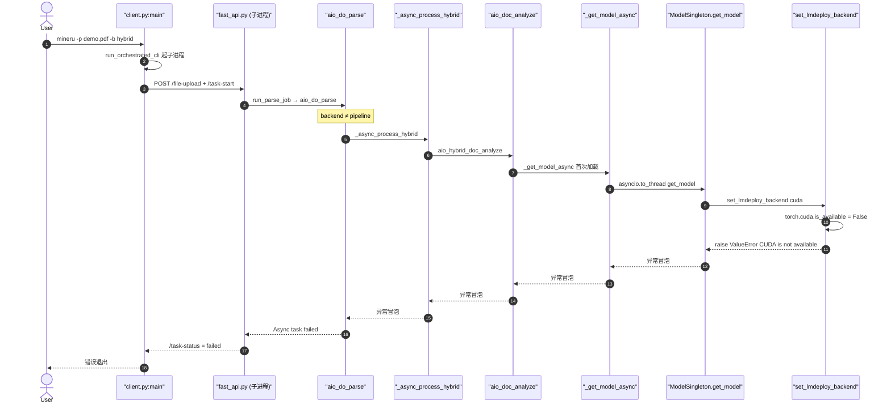
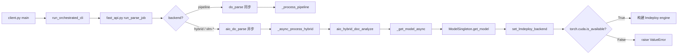

# 第 9 课配套时序图：MinerU VLM 调用链

把下面的 mermaid 代码块复制到 [mermaid.live](https://mermaid.live) 即可在线渲染。第 9 课 HTML 内嵌了相同源码，CDN 可用时自动渲染。

## 完整异步调用链 + CUDA 报错冒泡

## 同步链 vs 异步链分叉（mermaid flowchart）

## 关键节点行号对照

| 节点 | 文件:行号 | 说明 |
|---|---|---|
| main | `mineru/cli/client.py:1185` | Click 入口 |
| run_orchestrated_cli | `mineru/cli/client.py:910` | 起子进程 + 提交任务 |
| run_parse_job | `mineru/cli/fast_api.py:822` | 子进程里执行任务 |
| do_parse（同步） | `mineru/cli/common.py:668` | pipeline 后端走这里 |
| aio_do_parse（异步） | `mineru/cli/common.py:766` | hybrid / vlm-* 走这里 |
| _async_process_hybrid | `mineru/cli/common.py:508` | hybrid 分支 |
| aio_doc_analyze | `mineru/backend/hybrid/hybrid_analyze.py:1116` | hybrid 主入口 |
| _get_model_async | `mineru/backend/vlm/vlm_analyze.py:265` | asyncio.to_thread 包裹 |
| get_model | `mineru/backend/vlm/vlm_analyze.py:199` | ModelSingleton 单例 |
| set_lmdeploy_backend | `mineru/backend/vlm/utils.py:60` | ★ CUDA 检查点（raise 在 `:66`） |

## 渲染说明

- **HTML 内嵌版**：第 9 课 HTML 通过 `cdn.jsdelivr.net/npm/mermaid@10` 加载 mermaid.js，打开 HTML 自动渲染。无网环境下不渲染，但 `
` 折叠块里有源码可看。
- **GitHub / VS Code**：直接把本文档的 mermaid 代码块复制过去，GitHub README 和 VS Code Markdown Preview 都原生支持 mermaid。
- **在线编辑**：粘贴到 [mermaid.live](https://mermaid.live) 可以实时调整样式、导出 SVG/PNG。
